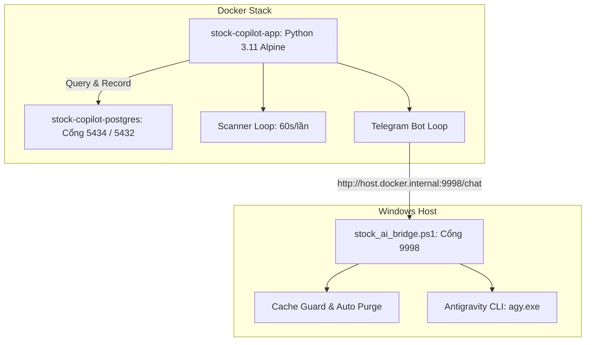

# 📈 Stock Copilot - Trợ Lý & Cố Vấn Đầu Tư Chứng Khoán AI Đa Quỹ

Hệ thống theo dõi thị trường chứng khoán Việt Nam (HOSE/HNX), quản lý danh mục tài sản đa quỹ, phát hiện mẫu hình nến đảo chiều realtime và tích hợp **Não bộ AI hội thoại tự nhiên (Google Gemini via Antigravity CLI)**.

Được đóng gói hoàn chỉnh bằng **Docker Container** với cơ chế bảo vệ bộ nhớ đệm và chống tràn RAM (**Cache Guard**).

---

## 🌟 Tính Năng Nổi Bật

1. **🏛️ Quản Lý Danh Mục Đa Quỹ & Lô Lẻ Realtime**:
   * Quản lý song song **Quỹ Cá Nhân** và **Quỹ Tiền Chung**.
   * Nhận diện lệnh mua/bán bằng ngôn ngữ tự nhiên: `Đã mua 10cp FPT giá 65,3`, `Quỹ chung đã mua 10cp CTG giá 30,05`.
   * Hỗ trợ sửa nhanh giá vốn, số lượng hoặc hoàn tác: `sửa giá thành 57.3`, `xóa giao dịch vừa rồi`.
   * Báo cáo danh mục tổng tài sản, lời/lỗ theo giá thị trường realtime và tỷ trọng ngành.

2. **📊 Bộ Quét Nến Đảo Chiều & Báo Cáo Chốt Phiên 15:00**:
   * Quét liên tục 24 cổ phiếu trụ cột dẫn đầu các ngành kinh tế (FPT, HPG, CTG, MBB, SSI, PVD, VHM, VIC...).
   * Nhận diện chuẩn xác các mẫu hình nến: **TĂNG GIÁ** (Bullish Hammer, Engulfing, Marubozu) & **GIẢM GIÁ** (Shooting Star, Bearish Engulfing, Xả bán tháo).
   * Cơ chế **Anti-Spam thông minh**: Tối đa 1 cảnh báo/mã/ngày khi xuất hiện mẫu hình nến then chốt.
   * Tự động gửi **Báo cáo tổng kết chốt phiên lúc 15:00** hằng ngày về Telegram.

3. **🧠 Não Bộ AI Hội Thoại Tự Nhiên (Gemini 3.8 Flash via agy)**:
   * Phản hồi sắc bén, hiểu bối cảnh tài sản thực tế và lịch sử trò chuyện.
   * Không dùng regex cứng nhắc; tự động xâu chuỗi lập luận khi hỏi sâu: *"500k thì nên giải ngân bao nhiêu cho PVD"*, *"Hãy phân tích PVD để tôi chuẩn bị các lệnh cho phiên tới"*.

4. **🛡️ Cơ Chế Bảo Vệ Cache Guard & Đóng Gói Docker**:
   * Chạy cô lập trong môi trường Docker Container.
   * **Cache Guard**: Tự động dọn dẹp cache đệm của `agy`, hạn chế dưới 20MB, khóa luồng đơn tránh tràn RAM, và cưỡng chế ngắt tiến trình treo sau 35s.

---

## 🏗️ Kiến Trúc Hệ Thống



---

## ⚡ Hướng Dẫn Khởi Động Nhanh (1-Click)

### 1. Bật hệ thống:
* Nhấp đúp vào file `start.bat`:
  * Tự động khởi chạy **AI Host Bridge (Cổng 9998)** với cơ chế Cache Guard.
  * Tự động kích hoạt toàn bộ Docker Container (`docker compose up -d`).

### 2. Tắt và dọn dẹp:
* Nhấp đúp vào file `stop.bat`:
  * Tự động dừng tất cả Container (`docker compose down`).
  * Dừng tiến trình Bridge và xóa sạch toàn bộ thư mục cache đệm tạm thời.

---

## 📂 Cấu Trúc Mã Nguồn

```text
stock-copilot/
├── app/
│   ├── main.py                 # Khởi chạy đồng thời Scanner và Telegram Bot
│   ├── bot.py                  # Xử lý tương tác Telegram 2 chiều & NLP giao dịch
│   ├── scanner.py              # Quét nến realtime & báo cáo chốt phiên 15:00
│   ├── market_data.py          # Lấy dữ liệu OHLC & nến realtime từ sàn HOSE
│   ├── db.py                   # Quản lý kết nối PostgreSQL & truy vấn dữ liệu
│   ├── ai_client.py            # Kết nối tới AI Host Bridge (agy/Gemini)
│   └── config.py               # Cấu hình môi trường
├── database/
│   └── init.sql                # Khởi tạo bảng PostgreSQL
├── engine/
│   └── stock_ai_bridge.ps1     # AI Host Bridge & Cache Guard daemon
├── docker-compose.yml          # Định nghĩa dịch vụ Docker (PostgreSQL & App)
├── Dockerfile                  # Đóng gói ứng dụng chạy trong Docker
├── start.bat                   # 1-click Bật toàn bộ hệ thống
├── stop.bat                    # 1-click Tắt và dọn dẹp hoàn toàn
└── README.md
```